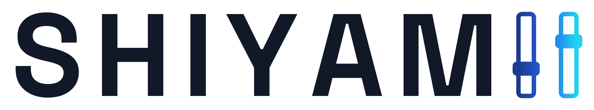
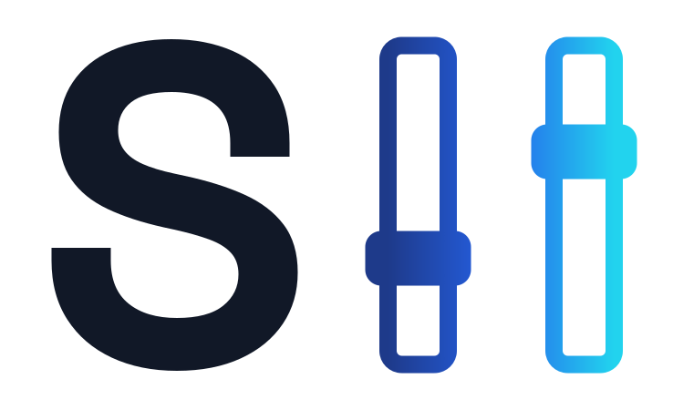
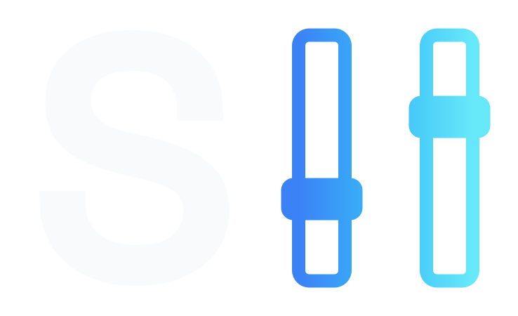
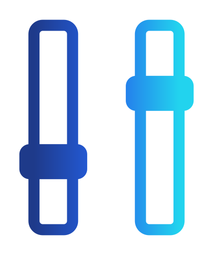
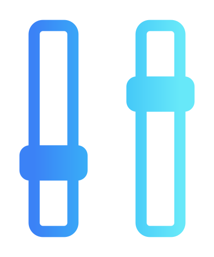
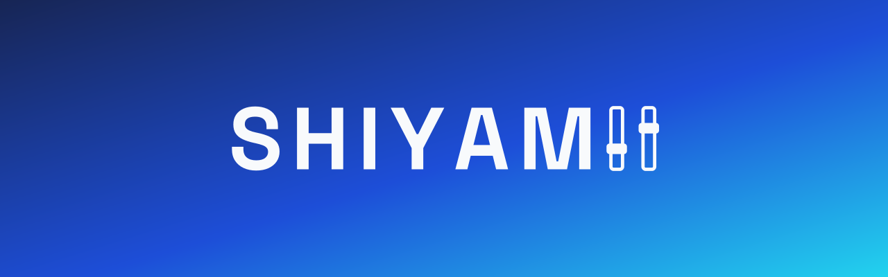
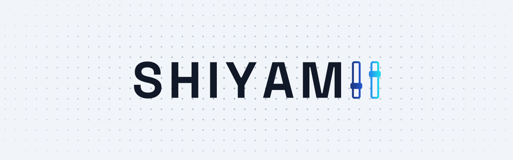
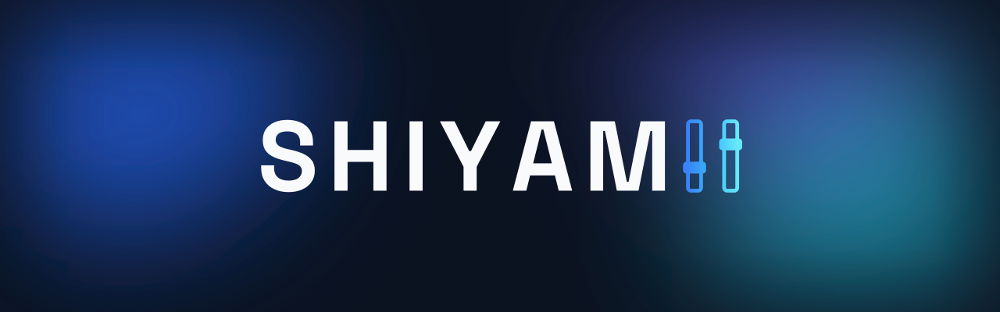

<p align="center">
  <picture>
    <source media="(prefers-color-scheme: dark)" srcset="logos/logo-complet-sur-sombre-couleur.svg">
    
  </picture>
</p>

# shiyamii-brand

Identité visuelle de **Shiyamii** : logos, fonds et favicons. C'est la signature de mes projets, de mes déploiements et de mon homelab.

Les fichiers sont servis par [jsDelivr](https://www.jsdelivr.com/) depuis ce dépôt.

## Utilisation

```text
https://cdn.jsdelivr.net/gh/Shiyamii/shiyamii-brand@<version>/<chemin>
```

- **Toujours préciser une version** (`@1.0.0`), jamais `@main`. Une version publiée ne change plus, donc un lien reste valide.
- Le logo n'a pas de fond. Choisis `sur-clair` pour un fond clair et `sur-sombre` pour un fond sombre.
- Les SVG sont la référence. Les PNG servent aux outils qui lisent mal le SVG.

## Logos

`logo-<forme>-sur-<clair|sombre>-<couleur|mono>.svg`

| Forme | Sur clair | Sur sombre |
|-------|-----------|------------|
| Complet |  |  |
| Monogramme |  |  |
| Symbole |  |  |

Chaque forme existe aussi en `mono` (les potards prennent la couleur du texte).

Liens directs (version `1.0.0`) :

| Fichier | URL |
|---------|-----|
| Complet, clair, couleur | `https://cdn.jsdelivr.net/gh/Shiyamii/shiyamii-brand@1.0.0/logos/logo-complet-sur-clair-couleur.svg` |
| Complet, sombre, couleur | `https://cdn.jsdelivr.net/gh/Shiyamii/shiyamii-brand@1.0.0/logos/logo-complet-sur-sombre-couleur.svg` |
| Monogramme, clair, couleur | `https://cdn.jsdelivr.net/gh/Shiyamii/shiyamii-brand@1.0.0/logos/logo-monogramme-sur-clair-couleur.svg` |
| Monogramme, sombre, couleur | `https://cdn.jsdelivr.net/gh/Shiyamii/shiyamii-brand@1.0.0/logos/logo-monogramme-sur-sombre-couleur.svg` |
| Symbole, clair, couleur | `https://cdn.jsdelivr.net/gh/Shiyamii/shiyamii-brand@1.0.0/logos/logo-symbole-sur-clair-couleur.svg` |
| Symbole, sombre, couleur | `https://cdn.jsdelivr.net/gh/Shiyamii/shiyamii-brand@1.0.0/logos/logo-symbole-sur-sombre-couleur.svg` |

## Fonds (gabarits)

`fond-<fond>-<format>.svg`, avec les formats `banniere-readme`, `banniere-social`, `avatar-symbole` et `avatar-monogramme`.

| Fond | Usage | Aperçu |
|------|-------|--------|
| `plain-color` | Contexte calme, contraste fort |  |
| `dark-point` | Fond sombre par défaut |  |
| `light-point` | Fond clair par défaut |  |
| `dark-aurore` | Variante décorative, grands formats |  |

## Favicons

`favicon-<tuile>-<taille>.{svg,png}` et `favicon-<tuile>.ico`, avec les tuiles `transparent-sur-clair`, `transparent-sur-sombre`, `sombre`, `clair` et `plain-color`. Tailles : 16, 24, 32, 48 et 64 px (512 px en PNG). Le dessin s'adapte à la taille.

```html
<link rel="icon" href="https://cdn.jsdelivr.net/gh/Shiyamii/shiyamii-brand@1.0.0/favicons/favicon-sombre.ico" sizes="any">
<link rel="icon" href="https://cdn.jsdelivr.net/gh/Shiyamii/shiyamii-brand@1.0.0/favicons/favicon-sombre-32.svg" type="image/svg+xml">
```

## Licence

Tous droits réservés. Tu peux afficher les fichiers sans les modifier pour faire référence à Shiyamii. Voir [LICENSE](LICENSE).
